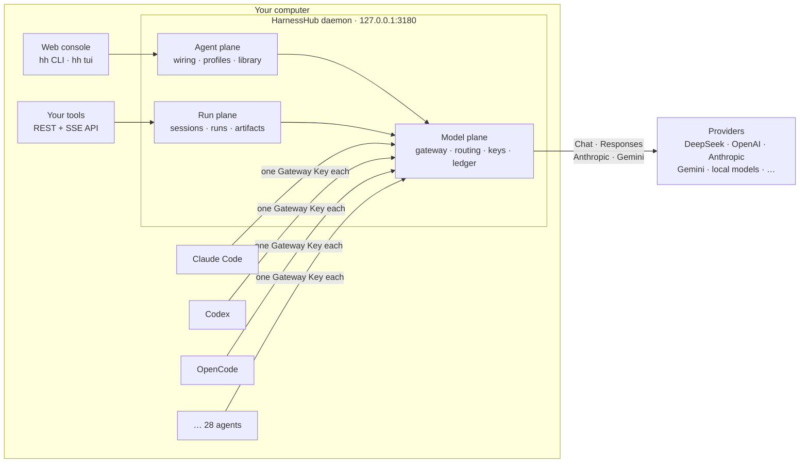

<div align="center">


<br>

[](https://github.com/wyzz973/HarnessHub/actions/workflows/ci.yml)
[](https://github.com/wyzz973/HarnessHub/actions/workflows/codeql.yml)
[](https://github.com/wyzz973/HarnessHub/actions/workflows/scorecard.yml)
[](LICENSE)


**Wire any coding agent to any model. Run agents headless through one API. Keep the evidence of every model call.**

[Quickstart](#quickstart) · [Why HarnessHub](#why-harnesshub) · [Architecture](#how-it-works) · [Docs](docs/README.md) · [Roadmap](ROADMAP.md) · [中文](README.zh-CN.md)

</div>

> [!NOTE]
> **Pre-release (milestone M0).** There is no published release yet. HarnessHub runs from source on your own machine, and interfaces will change before 0.1. The [roadmap](ROADMAP.md) lists what each milestone delivers.

---

## Why HarnessHub

You probably use more than one coding agent: Claude Code for one job, Codex for another, OpenCode or Qwen Code for a third. Each keeps its own model settings, its own API key, its own idea of what a "tool" is, and its own opaque bill. When you want to try one model across all of them, or let an agent run unattended, or find out where the money went, you are editing a dozen config files by hand.

HarnessHub is a daemon on your own computer that takes over that job.

- **Switch models for all of your agents in one place.** Pick a model once and HarnessHub writes it into each agent's own configuration, after showing you the diff.
- **Run agents without a human at the keyboard.** Start an agent through a REST + SSE API, answer its permission requests, collect its files.
- **Know what happened.** Every model call is a row in a ledger. A run does not count as finished because an agent exited 0; it finishes when the model calls have settled and the declared outputs are verified.

Nothing leaves your machine. There is no hosted service, no account and no telemetry.

## Highlights

<table>
<tr>
<td width="33%" valign="top">

### Model plane
A local gateway for the OpenAI **Chat Completions**, OpenAI **Responses**, **Anthropic Messages** and **Gemini** protocols, with passthrough or translation between them.

- 46 provider presets, plus your own
- Route groups, rules, retries and failover
- Per-key model allowlists and budgets
- A `model.call` ledger with usage and cost
- ChatGPT and GitHub Copilot subscriptions as providers

</td>
<td width="33%" valign="top">

### Agent plane
Wires the agents already installed on your machine, by editing **their own** config files, and never silently.

- 28 agents, each with its own Gateway Key
- Preview, byte-exact backup, restore
- Drift detection if you edit a file yourself
- Profiles for named setups
- A Library of instructions, MCP servers and Skills, synced into nine agents

</td>
<td width="33%" valign="top">

### Run plane
Runs agents headless and records what they did.

- Durable Sessions and Runs in SQLite
- SSE replay from committed events
- Deadlines, cancellation, idempotent submit
- Permission round-trips over the API
- Declared outputs stored as immutable, SHA-256-hashed artifacts
- ACP and CLI drivers, one private config per Session

</td>
</tr>
</table>

**And around them:** a web console served by the daemon itself (React, English and Chinese), a terminal UI (`hh tui`), encrypted backups with WebDAV/S3 sync, OTLP export of model calls, secrets kept in the system keychain, and LAN sharing of one gateway with other computers.

## How it works



Everything runs in one process on one port. Because the run plane and the model plane share it, a task's model calls are recorded against that task, so the evidence comes from the same system that did the work.

### Design choices that matter

| Choice | Why |
|---|---|
| **One Gateway Key per agent** | Revoke, cap or audit one agent without touching the others. Keys are stored as hashes; provider credentials live in the system keychain, never in agent files. |
| **Drift, not overwrite** | If you edit an agent's config after HarnessHub wired it, that is reported as drift. HarnessHub does not quietly rewrite your file. |
| **Preview before write** | Every wiring shows the exact file changes, backs up the original bytes, writes atomically, reads back, and can restore exactly. |
| **Evidence-based results** | A run is settled by its model-call ledger and verified artifacts. Exit code 0, a dropped event stream or an agent saying "done" is not proof. |
| **Local by default** | The gateway accepts loopback connections only until you turn LAN sharing on. |

## Quickstart

### Install from source

**Requirements:** Git, Node.js 24.20.0 and pnpm 10.12.3 (`corepack enable` provides it). On macOS the Xcode Command Line Tools build the Keychain helper.

```sh
git clone https://github.com/wyzz973/HarnessHub.git
cd HarnessHub
pnpm install --frozen-lockfile
pnpm build && pnpm build:console
```

### Run it

**1. Start the daemon.**

```sh
pnpm exec hh serve
```

It listens on `127.0.0.1:3180`, keeps data in `./data`, and prints a one-time link to the console.

**2. Add a provider and wire your agents.** In a second terminal:

```sh
pnpm exec hh init
```

The wizard adds a provider from a preset, asks for its key without echo, lists the agents installed here, shows every file change together and, once you confirm, wires them to the model you pick. For scripts:

```sh
pnpm exec hh init --preset deepseek --credential-from-env DEEPSEEK_API_KEY \
  --agents claude,codex --model deepseek/<model> --yes
```

**3. Call a model through the gateway.**

```sh
HH_KEY=$(pnpm exec hh key create --name me --allow 'deepseek/*')
curl http://127.0.0.1:3180/v1/chat/completions \
  -H "Authorization: Bearer $HH_KEY" -H 'content-type: application/json' \
  -d '{"model":"deepseek/<model>","messages":[{"role":"user","content":"Hello"}]}'

pnpm exec hh usage --by model --since 1d
```

**No API key?** The repository ships a [fake provider](tools/fake-provider/README.md) that answers every request with fixed text and calls no real model, enough to try every step above.

<details>
<summary><b>More things to try</b></summary>

```sh
pnpm exec hh agents                         # which agents are installed, wired, drifted
pnpm exec hh wire codex deepseek/<model>    # preview, confirm, wire one agent
pnpm exec hh tui                            # the same, in the terminal
pnpm exec hh unwire codex                   # restore its files and revoke its key
pnpm exec hh console                        # a fresh sign-in link for the web console
```

OpenAI clients use `http://127.0.0.1:3180/v1` as their base URL; Anthropic and Gemini clients use `http://127.0.0.1:3180`. Use the Gateway Key as the API key. `hh status` prints these addresses.

</details>

The full walkthrough, including data directories and troubleshooting, is in [getting started](docs/getting-started.md) (Chinese).

## CLI overview

`hh --help` lists the commands and `hh <command> --help` describes one.

| Commands | What they do |
|---|---|
| `serve`, `version`, `config`, `status`, `console` | Start the daemon, print the build, show or edit `config.jsonc`, show the running daemon, sign in to the console |
| `init` | Add a provider from a preset and wire the agents installed here in one go |
| `provider`, `import`, `credential`, `model`, `catalog` | Providers from presets or by hand, import links, their keys, model metadata and the models.dev catalog |
| `key`, `group`, `usage`, `gateway` | Gateway Keys and budgets, route groups and rules, usage from the ledger, LAN sharing |
| `subscription` | Sign a ChatGPT or Copilot account in for agents on this computer |
| `agents`, `wire` (`use`), `unwire`, `profile`, `tui` | Global wiring of the agents installed here |
| `library` | Instructions, MCP servers and Skills, synced into agents |
| `backup`, `restore`, `sync` | Encrypted backups, and sync through WebDAV or S3 |
| `benchmark`, `tools`, `rollout` | Benchmarks of headless runs, Tool Packs and rollout export |

## Supported agents

The agent plane wires **28 agents**, each following the way that agent reads its own configuration. A selection:

| | | | |
|---|---|---|---|
| Claude Code | Codex CLI | Gemini CLI | Qwen Code |
| OpenCode | Crush | Pi | Kimi Code |
| Hermes Agent | Droid | Cline CLI | Qoder |
| Claude Desktop | WorkBuddy | dsh | Command Code |

Which files and keys each agent gets, and the safety rules around writing them, are in [global wiring](docs/global-wiring.md) (Chinese). How these agents behave when actually run is in [compatibility](docs/compatibility.md).

## Where HarnessHub fits

The space has three layers, and few projects join them:

| Layer | Question it answers | Typical projects | HarnessHub |
|---|---|---|---|
| **Model** | Which model does each agent use? | CC Switch, claude-code-router, [Magpie](https://github.com/yetone/magpie), LiteLLM | At parity with Magpie; any of these can also be an upstream provider |
| **Execution** | How do I get an agent to do work unattended? | OpenHands, sandbox-agent, acpx | The main focus |
| **Observation** | What happened and what did it cost? | ccusage, Langfuse, OpenTelemetry | The ledger and run events are the evidence, exported over OTLP to your own system |

### Relationship to Magpie

HarnessHub's model and agent planes reimplement, in TypeScript, what [Magpie](https://github.com/yetone/magpie) by yetone (MIT) does in Go, checked against Magpie's source, and add the run plane on top. Thanks to that project for the design and its field-level knowledge of each agent. [HarnessHub for Magpie users](docs/magpie-parity.md) compares the two area by area, including the gaps. The positioning, with an honest account of what is and is not built, is in [HarnessHub's positioning](docs/features/positioning.md) (Chinese).

## Status

| | |
|---|---|
| **Tested** | `pnpm check` (build, lint, unit, integration, smoke, 508 protocol-conformance cases) passes on macOS arm64 |
| **Not verified** | Windows support is implemented but has not been run on Windows. A single-executable build exists for macOS arm64 only |
| **Real providers and agents** | End to end with DeepSeek; real-agent results are in [compatibility](docs/compatibility.md) |
| **Coming** | A versioned `/api/v1` for the run plane and SDKs, per-task usage for every run, multi-agent comparison runs, the first installable release ([roadmap](ROADMAP.md)) |

## Documentation

Most documentation is in Chinese; English becomes the primary language with the documentation site planned for 0.1. The [documentation index](docs/README.md) describes every document in English.

| Topic | Start here |
|---|---|
| Setup and configuration | [quickstart](docs/quickstart.md) · [configuration](docs/configuration.md) · [console](packages/console/README.md) |
| Model gateway | [model gateway](docs/model-gateway.md) · [provider presets](docs/provider-presets.md) · [gateway features](docs/gateway-features.md) |
| Agents | [global wiring](docs/global-wiring.md) · [Library](docs/library.md) |
| HTTP API | [overview](docs/api/README.md) · [reference](docs/api/reference.md) · [OpenAPI](docs/api/openapi.json) |
| Design | [open-source design](docs/proposals/oss/README.md) · [DESIGN.md](DESIGN.md) · [architecture](docs/architecture.md) · [decision records](docs/decisions/README.md) |

## Development

```sh
pnpm check              # build, lint, tests, API and docs checks, console build
pnpm bench              # gateway latency and ledger throughput against the M1 targets
pnpm test:conformance   # real agents installed here, run offline in a sandbox (macOS)
```

[AGENTS.md](AGENTS.md), [development](docs/development.md) and [testing](docs/testing.md) hold the rules every change follows. The monorepo is split into `packages/` (`gateway`, `agents`, `runtime`, `drivers`, `store`, `secrets`, `daemon`, `console`, `sdk`, …) with import boundaries that `pnpm check:boundaries` enforces.

## Contributing

Contributions are welcome. Read [CONTRIBUTING.md](CONTRIBUTING.md) first; changes are accepted under the [Developer Certificate of Origin](https://developercertificate.org/) (`git commit -s`). Report vulnerabilities privately as described in [SECURITY.md](SECURITY.md). Questions go to [SUPPORT.md](SUPPORT.md); project decisions are described in [GOVERNANCE.md](GOVERNANCE.md).

HarnessHub is owned by [@wyzz973](https://github.com/wyzz973). Day-to-day development and maintenance are carried out by an AI maintainer (Claude) under the owner's authorization, and every change goes through the same automated checks.

## License

[MIT](LICENSE). Code and data taken from other projects keep their own licenses, listed in [THIRD_PARTY_NOTICES.md](THIRD_PARTY_NOTICES.md).

HarnessHub is not affiliated with the GitHub organization `HarnessHub`, with Harness Inc., or with the vendors of the agents and models it works with. Product names are used only to describe compatibility; see [TRADEMARKS.md](TRADEMARKS.md). The earlier single-model edition remains on the `archive/competition` branch.
