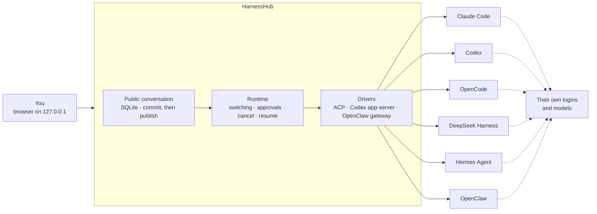

<div align="center">


<br>

[](LICENSE)


**One chat for Claude Code, Codex, OpenCode, Hermes, OpenClaw and the other coding harnesses already on your Mac.<br>Each one keeps its own install, its own login and its own models.**

[Quickstart](#quickstart) · [Why](#why-harnesshub) · [How it works](#how-it-works) · [Harnesses](#supported-harnesses) · [Docs](docs/README.md) · [中文](README.zh-CN.md)

<br>

https://github.com/user-attachments/assets/9a2af277-9fa9-48e8-9d26-08b61bc80ca8

<sub>HarnessHub in 52 seconds, with sound: OpenCode plans, Claude Code builds, Codex reviews, DeepSeek Harness verifies, OpenClaw reports back · <a href="docs/assets/promo.mp4?raw=true">download the 1080p MP4</a></sub>

</div>

> [!NOTE]
> **Pre-release, macOS only.** HarnessHub runs from source on your own Mac. There is no published release yet, and the interface is in Chinese for now. Every claim below links to the evidence it rests on; [what is not done yet](#status) is listed just as plainly.

---

## Why HarnessHub

You already have more than one coding harness. Claude Code in one terminal, Codex in another, OpenCode or Hermes or OpenClaw somewhere else. Each has its own window, its own way to pick a model, its own approvals and its own history. The moment a task outgrows one of them, you copy the context by hand into the next.

HarnessHub puts all of them behind **one conversation**:

- **Ask any harness, from one place.** Pick Claude Code for one message and Codex for the next. The conversation, its history and your draft stay where they are.
- **Nothing is emulated.** HarnessHub drives the program you installed, through its own interface (ACP, Codex's app-server, OpenClaw's gateway). It uses your login and the models that harness already offers. It never creates an empty profile and never rewrites your global model settings.
- **Native features come through as they are.** Models, thinking levels, modes and commands are read from each harness. Approvals, questions, plans, tool calls with diffs, sub-agents and usage show up in the chat the way that harness reports them.
- **Your harnesses, kept up to date.** HarnessHub finds what is installed through official channels, and can install, upgrade or uninstall each harness the way its vendor documents, with every command shown before it runs.

Everything stays on your machine. The page is served on `127.0.0.1`, signed in with a one-time link, and the data lives in a SQLite database you own.

## Highlights

<table>
<tr>
<td width="33%" valign="top">

### One conversation
- A public conversation that belongs to no single harness
- Switch harness, model or thinking level between messages, with no "Apply" button
- A marker shows where another harness took over
- Hand off mid-task: the next harness gets a handoff packet with your words, what each harness did and the files it changed; one that comes back gets only what it missed
- Resume a harness's own sessions, or branch from any reply
- Replies stream over SSE and survive reloads; nothing is sent twice

</td>
<td width="33%" valign="top">

### Native, per harness
- Models, thinking levels, modes and `/` commands from each harness
- Approvals docked at the composer: <kbd>⏎</kbd> allow once, <kbd>esc</kbd> deny
- Plans, tool input and output with diffs, sub-agents, compaction, usage
- Files, images and audio sent through each harness's own input
- `/compact` and `/export` handed to the harness that has them

</td>
<td width="33%" valign="top">

### Your Mac, managed
- Discovery of official installs only: npm, Homebrew, vendor scripts, uv
- Install, upgrade and uninstall with a preview of every command
- Upgrades restart the harness's own background services, then check them
- One page for skills, MCP servers, instructions, commands, hooks and plugins across harnesses, user-level only, previewed before each write

</td>
</tr>
</table>

## How it works



The conversation is HarnessHub's; each harness keeps its own native session underneath. Facts are committed to the database before they are shown, so a reload replays exactly what happened and an unknown outcome is never re-run on its own. When you switch, the next harness is given a handoff packet: the conversation so far, folded to a bounded budget, with what was left out said plainly. A harness that returns to a native session it already has receives only what it has not seen yet, and a conversation with one harness gets nothing added at all. Vendor SDK types stay inside the drivers; the rest of the code never branches on which harness it is talking to.

## Supported harnesses

HarnessHub focuses on seven harnesses ([ADR-046](docs/decisions/0046-harness-focus-hardening.md)) and adapts to each one's latest official release ([ADR-053](docs/decisions/0053-latest-version-baseline.md)). The [capability matrix](docs/verification/native-capability-matrix.md) tracks 27 native features per harness, each with its source and evidence.

| Harness | Driven through | Native features done in HarnessHub (of 27 tracked) |
|---|---|---|
| **Claude Code** | ACP, via `claude-agent-acp` bound to your own `claude` | 22 of 27 |
| **Codex** | Codex app-server | 20 of 27 |
| **OpenCode** | ACP (`opencode acp`) | 16 of 27 |
| **Hermes Agent** | ACP, attached to your running gateway | 16 of 27 |
| **DeepSeek Harness** | ACP, through `dsh`'s own profile | 13 of 27 |
| **OpenClaw** | ACP plus your own OpenClaw gateway | 10 of 27 |
| **WorkBuddy** | Planned: the embedded CodeBuddy CLI on WorkBuddy's own data ([ADR-048](docs/decisions/0048-harness-scope-and-workbuddy.md)) | not yet |

"Wired" means implemented in HarnessHub; the matrix records separately which of them passed with the real harness on this Mac. Cursor, Gemini CLI and Pi have drivers too but are frozen outside the focus. The catalog describes 45 products; being listed there does not mean a harness can be driven.

## Quickstart

**Requirements:** macOS, Node.js 24 or later, pnpm 10.12.3, and at least one harness from the table above, installed and signed in the official way.

```sh
git clone https://github.com/wyzz973/HarnessHub.git
cd HarnessHub
pnpm install --frozen-lockfile --ignore-scripts
pnpm build && pnpm web:build
pnpm web --cwd /path/to/your/project --data-dir data --port 4317
```

Open the one-time link it prints. The token is exchanged for a local cookie and removed from the address bar; the service listens on `127.0.0.1` only. Closing the page does not cancel a reply, and <kbd>Ctrl</kbd>+<kbd>C</kbd> waits for running work to wind down and keeps the history. The service owns its `--data-dir` while it runs.

<details>
<summary><b>Without the web page</b></summary>

```sh
pnpm discover                                    # official installs found here, with channels and versions
pnpm chat --harness codex --data-dir data --cwd /path/to/project
pnpm sessions list --data-dir data --json        # public conversations
pnpm sessions check-upgrade --data-dir data      # before an upgrade: what it would do, read-only, nothing written
```

In `pnpm chat`, `:harness opencode` switches harness, `:cancel` stops the current turn and `:history` prints the public history. See [engineering status](docs/engineering/status.md) for every command and flag.

</details>

## Status

HarnessHub is pre-release. To keep the claims honest, the project separates *designed*, *implemented*, *passing synthetic tests* and *passing with the real harness*:

| | |
|---|---|
| **Tested** | `pnpm check` (build, web build, boundary, wording and tooling checks), `pnpm test` (996 passing) and the browser suite `pnpm test:web` run on macOS arm64 |
| **Real harnesses** | Recorded per feature in the [capability matrix](docs/verification/native-capability-matrix.md) and the [verification records](docs/verification/); some features are blocked by plan or quota limits on the test account and are marked as such |
| **Relay** | The handoff packet between harnesses passes synthetic tests; in real-harness smoke tests (on storage v12), OpenCode → DeepSeek Harness → OpenCode passed end to end, and Claude Code → Codex passed its handoff, while Claude Code (on haiku), back on its own session, misread a delta that was correct. The business store is now v13: it migrates v12 data and has the relay tables, which nothing writes yet. Delivery records, calibrated budgets and an omission view in the interface build on them ([ADR-055](docs/decisions/0055-relay-and-context-scheduling.md)) |
| **Designed** | Long-lived native hosts instead of one process per turn ([ADR-056](docs/decisions/0056-native-hosts-and-sessions.md)) |
| **Not planned** | Windows and Linux ([ADR-044](docs/decisions/0044-macos-official-channels.md)) |
| **Later** | Managing model providers centrally; for now each harness uses the models it is configured with |
| **About the film** | The relay, the conversation and its numbers are illustrative. The five legs follow what each harness is known for; sending the summary to a phone is OpenClaw's own messaging feature and has not been verified through HarnessHub |

## Documentation

The documentation is in Chinese.

| Topic | Start here |
|---|---|
| Overview and reading order | [docs/README.md](docs/README.md) · [engineering status](docs/engineering/status.md) |
| What this release can do | [Feature list of the minimum usable version](docs/product/mvp-2026-11-09.md), with its evidence and limits |
| Decisions | [ADR index](docs/decisions/README.md), 49 records |
| Contracts and invariants | [contracts](docs/contracts/) · [invariants](docs/domain/invariants.md) |
| Evidence | [capability matrix](docs/verification/native-capability-matrix.md) · [verification records](docs/verification/) |
| Plan | [tasks](TASKS.md) · [test matrix](docs/engineering/test-matrix.md), generated from [`plan/`](plan/) |

## Development

```sh
pnpm check       # build, web build, boundary checks, UI wording, tooling tests
pnpm test        # unit, integration, protocol and recovery tests against real files and processes
pnpm test:web    # the web page in a real browser (needs: pnpm exec playwright install chromium)
```

[AGENTS.md](AGENTS.md), [development](docs/engineering/development.md) and [testing](docs/engineering/testing.md) hold the rules every change follows: one owner per file, contracts before code, facts committed before they are published, and no test that stands in for the real harness without saying so.

## License

[MIT](LICENSE). Brand icons come from [Lobe Icons](https://github.com/lobehub/lobe-icons) (MIT) and other sources listed in [web/THIRD_PARTY_ASSETS.md](web/THIRD_PARTY_ASSETS.md); product names and marks belong to their owners and are used only to identify the harnesses HarnessHub works with. HarnessHub is not affiliated with Anthropic, OpenAI, DeepSeek, Nous Research, Tencent, the OpenCode or OpenClaw projects, or the GitHub organization `HarnessHub`.

The project's engineering name is HarnessGateway, which is why the package is called `harness-gateway`. The earlier control-plane edition of HarnessHub is kept on the [`archive/control-plane`](https://github.com/wyzz973/HarnessHub/tree/archive/control-plane) branch.
