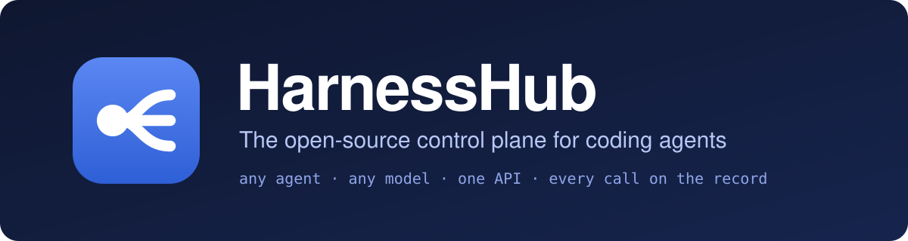
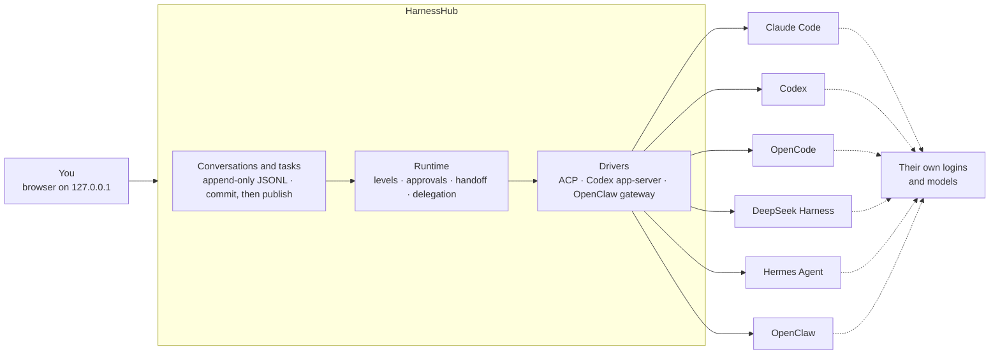

<div align="center">



<br>

[](LICENSE)


**One chat for Claude Code, Codex, OpenCode, Hermes, OpenClaw and the other coding harnesses already on your Mac.<br>Each one keeps its own install, its own login and its own models.**

[Quickstart](#quickstart) · [Why](#why-harnesshub) · [How it works](#how-it-works) · [Harnesses](#supported-harnesses) · [Docs](docs/README.md) · [中文](README.zh-CN.md)

<br>

https://github.com/user-attachments/assets/9a2af277-9fa9-48e8-9d26-08b61bc80ca8

<sub>HarnessHub in 52 seconds, with sound: OpenCode plans, Claude Code builds, Codex reviews, DeepSeek Harness verifies, OpenClaw reports back · <a href="docs/assets/promo.mp4?raw=true">download the 1080p MP4</a></sub>

</div>

> [!NOTE]
> **Pre-release, macOS only.** HarnessHub runs from source on your own Mac. There is no published release yet, and the interface is in Chinese for now. Every claim below links to the evidence it rests on; [what is not done yet](#status) is listed just as plainly.

---

## Why HarnessHub

You already have more than one coding harness. Claude Code in one terminal, Codex in another, OpenCode or Hermes or OpenClaw somewhere else. Each has its own window, its own way to pick a model, its own approvals and its own history. The moment a task outgrows one of them, you copy the context by hand into the next.

HarnessHub puts all of them behind **one conversation**:

- **Ask any harness, from one place.** Pick Claude Code for one message and Codex for the next. The conversation, its history and your draft stay where they are.
- **Let them work together.** Hand a task over halfway, or delegate a part of it to another harness. HarnessHub keeps the whole task: what you said, what each harness did and the files it changed. The next harness gets what it needs and can read the rest for itself.
- **Nothing is emulated.** HarnessHub drives the program you installed, through its own interface (ACP, Codex's app-server, OpenClaw's gateway). It uses your login and the models that harness already offers. It never creates an empty profile and never rewrites your global model settings.
- **Native features come through as they are.** Models, thinking levels, modes and commands are read from each harness. Approvals, questions, plans, tool calls with diffs, sub-agents and usage show up in the chat the way that harness reports them.
- **Your harnesses, kept up to date.** HarnessHub finds what is installed through official channels, and can install, upgrade or uninstall each harness the way its vendor documents, with every command shown before it runs.

HarnessHub keeps everything on your machine. The page is served on `127.0.0.1` and signed in with a one-time link. The data is a folder you own, with one append-only JSONL file per conversation.

## Highlights

<table>
<tr>
<td width="50%" valign="top">

### One conversation
- A conversation that belongs to no single harness: switch harness, model or thinking level between messages, with no "Apply" button
- Five permission levels and five thinking levels for every harness, carried out through each one's own settings, or by the Hub where a harness has no setting for a level
- Approvals docked at the composer: <kbd>⏎</kbd> allow, <kbd>esc</kbd> deny
- Plans, tool calls with diffs, sub-agents and usage, as each harness reports them
- Resume, branch, edit and resend; clearing starts a new native session
- Replies stream over SSE and survive reloads; nothing is sent twice

</td>
<td width="50%" valign="top">

### Harnesses working together
- Hand off halfway: the next harness gets the conversation so far, up to half its context window; one that comes back gets only what it missed
- Delegate a part of the work to another harness, from the menu or by the harness itself; it runs in a conversation of its own and the result comes back by itself
- A task board that every harness on the task goes by
- The whole record of the task as read-only files, which each harness reads with its own tools
- When a harness compacts its context, the Hub hands it the task's state again

</td>
</tr>
<tr>
<td width="50%" valign="top">

### A workbench for code
- A finished turn folds into one line, with a card of the files it changed
- Changes by turn, by conversation or by Git range, side by side, with remarks on lines
- A Git worktree for a conversation if you want one, and checkpoints around every turn; in that worktree, edit-and-resend can put the files back
- Commit, push and open a pull request with your own `gh`
- A terminal that keeps running, and your editor one click away
- Steer a running turn (Claude Code, Codex); <kbd>⌘</kbd><kbd>K</kbd> searches every conversation

</td>
<td width="50%" valign="top">

### Your Mac, managed
- Discovery of official installs only: npm, Homebrew, vendor scripts, uv
- Install, upgrade and uninstall with a preview of every command
- Upgrades restart the harness's own background services, then check them
- One page for skills, MCP servers, instructions, sub-agents and plugins across harnesses, user-level only, previewed before each write

</td>
</tr>
</table>

## How it works



The conversation is HarnessHub's; each harness keeps its own native session underneath. Facts are written to disk before they are shown, so a reload replays exactly what happened and an unknown outcome is never re-run on its own.

When you switch, the next harness is given a handoff packet: the conversation so far, up to half of its context window, with whatever was left out said plainly. A harness that returns to a native session it already has receives only what it has not seen yet, and a conversation with one harness gets nothing added at all.

Every harness also gets a few tools from the Hub, through the session's MCP servers (OpenClaw runs them as a command): a task list and a wrap-up that the page shows, the task board, and delegation to another harness. The whole record of the task, with every conversation on it and every turn in full, is a read-only folder the harness reads with its own file tools. A harness that compacts its context gets the task's state back with its next tool call. Only when a native session cannot go on does the Hub start a new one.

Vendor SDK types stay inside the drivers. How each harness is adapted is a declaration of its own, and the rest of the code never branches on which harness it is talking to.

## Supported harnesses

HarnessHub adapts to each harness's latest official release ([ADR-053](docs/decisions/0053-latest-version-baseline.md)). The [adapter matrix](docs/contracts/harness-adapters.md) says, for every feature and every harness, how it is adapted (natively, by a session setting, or by the Hub's policy) and what was checked on a real install.

| Harness | Driven through | The Hub's tools reach it through | Steer a running turn |
|---|---|---|---|
| **Claude Code** | ACP, via `claude-agent-acp` bound to your own `claude` | Session MCP, appended system prompt | Yes |
| **Codex** | Codex app-server | Thread MCP config, developer instructions | Yes |
| **OpenCode** | ACP (`opencode acp`) | Session MCP | Not offered natively |
| **DeepSeek Harness** | ACP, through `dsh`'s own profile | Session MCP | Not offered natively |
| **Hermes Agent** | ACP, attached to your running gateway | Session MCP | Not offered natively |
| **OpenClaw** | ACP plus your own OpenClaw gateway | A command for the conversation, run with its own exec tool | Not offered natively |
| **WorkBuddy** | Planned: the embedded CodeBuddy CLI on WorkBuddy's own data ([ADR-048](docs/decisions/0048-harness-scope-and-workbuddy.md)) | not yet | not yet |

All six have the five permission levels and the five thinking levels (each mapped to the nearest one the model supports), plan mode, approvals, native `/` commands, attachments, usage, resume and branching (natively where the harness can branch, otherwise by the Hub). Cursor, Gemini CLI and Pi have drivers too, but they are frozen and hidden. The catalog describes 45 products; being listed there does not mean a harness can be driven.

## Quickstart

**Requirements:** macOS, Node.js 24 or later, pnpm 10.12.3, and at least one harness from the table above, installed and signed in the official way. Optional: `git` for the changes page and worktrees, and `gh`, signed in, to open pull requests.

```sh
git clone https://github.com/wyzz973/HarnessHub.git
cd HarnessHub
pnpm install --frozen-lockfile --ignore-scripts
pnpm build && pnpm web:build
pnpm web --cwd /path/to/your/project --data-dir data --port 4317
```

Open the one-time link it prints. The token is exchanged for a local cookie and removed from the address bar; the service listens on `127.0.0.1` only, and the sign-in lasts while you use it, ending after eight hours without activity. Closing the page does not cancel a reply, and <kbd>Ctrl</kbd>+<kbd>C</kbd> waits for running work to wind down and keeps the history.

The service owns its `--data-dir` while it runs. Each conversation is one append-only JSONL file under `data/sessions/`, and the records of each task are under `data/context/`. A conversation without a folder works in `~/HarnessHub/chats`, and one that asks for its own worktree gets it under `~/HarnessHub/worktrees`. `pnpm web --help` lists every flag.

<details>
<summary><b>Without the web page</b></summary>

```sh
pnpm discover                                    # official installs found here, with channels and versions
pnpm chat --harness codex --data-dir data --cwd /path/to/project
pnpm sessions list --data-dir data --json        # conversations
```

In `pnpm chat`, `:harness opencode` switches harness, `:cancel` stops the current turn, `:history` prints the history and `:quit` leaves. Each command takes `--help`.

</details>

## Status

HarnessHub is pre-release. To keep the claims honest, the project separates *implemented*, *passing synthetic tests* and *passing with the real harness*, and the [feature list](docs/product/features.md) marks each feature that way.

| | |
|---|---|
| **Tested** | `pnpm check` passes (build, web build, boundary, wording and tooling checks). At the last full run (2026-11-14, macOS arm64), `pnpm test` passed 1,312 tests and the browser suite `pnpm test:web` passed 114 |
| **Real harnesses** | Each cell of the [adapter matrix](docs/contracts/harness-adapters.md) says what was checked on a real install and when; the [decisions log](docs/decisions/LOG.md) records every real run and what it did not cover |
| **Working together** | The [delegation ruler](docs/verification/delegation-ruler.md) hands real tasks between Claude Code (on Haiku), DeepSeek Harness and Codex. On default settings on 2026-11-14, S1–S14 passed (S14 with Claude Code's early-compaction switch). In S15 Codex passed; Claude Code did the task but was failed for listing a folder outside the workspace |
| **Synthetic tests only** | Opening a pull request and pushing to a real remote; Claude Code's fast tier; starting a new native session after the context window overflows or a session is lost. The rest are listed in the [feature list](docs/product/features.md) |
| **Not built yet** | A pool of long-lived native hosts shared between conversations ([ADR-056](docs/decisions/0056-native-hosts-and-sessions.md)); today each conversation keeps its own native process. A packaged app, for which the terminal's `node-pty` binaries would need signing and notarizing |
| **Later** | WorkBuddy; managing model providers centrally (for now each harness uses the models it is configured with) |
| **Not planned** | Windows and Linux ([ADR-044](docs/decisions/0044-macos-official-channels.md)) |
| **About the film** | The relay, the conversation and its numbers are illustrative. The five legs follow what each harness is known for; sending the summary to a phone is OpenClaw's own messaging feature and has not been verified through HarnessHub |

## Documentation

The documentation is in Chinese.

| Topic | Start here |
|---|---|
| What it can do now | [Feature list](docs/product/features.md), with the evidence for each feature and what is not done |
| Each harness, feature by feature | [Adapter matrix](docs/contracts/harness-adapters.md) |
| Decisions and real runs | [Decisions log](docs/decisions/LOG.md), newest first · [ADR index](docs/decisions/README.md), 50 records |
| Evidence | [Verification records](docs/verification/) · [delegation ruler](docs/verification/delegation-ruler.md) · [relay ruler](docs/verification/relay-ruler.md) |
| Reading order | [docs/README.md](docs/README.md) |

`plan/`, `TASKS.md`, the test matrix, the invariants and the readiness gates stopped being maintained on 2026-11-11. The [engineering status](docs/engineering/status.md) page and the generated [capability matrix](docs/verification/native-capability-matrix.md) are older snapshots. They are all kept for reference.

## Development

```sh
pnpm check       # build, web build, boundary checks, UI wording, tooling tests
pnpm test        # unit and integration tests against real files and processes
pnpm test:web    # the web page in a real browser (needs: pnpm exec playwright install chromium)
```

The `pnpm test:real:*` scripts drive the harnesses installed on this Mac, with their real models. [AGENTS.md](AGENTS.md) holds how work is done here: small slices tried on a real Mac, a build before every commit, facts committed before they are published, no change to your real harness configuration, and reports that keep code done, synthetic tests and real-harness results apart.

## License

[MIT](LICENSE). Brand icons come from [Lobe Icons](https://github.com/lobehub/lobe-icons) (MIT) and other sources listed in [web/THIRD_PARTY_ASSETS.md](web/THIRD_PARTY_ASSETS.md); product names and marks belong to their owners and are used only to identify the harnesses HarnessHub works with. HarnessHub is not affiliated with Anthropic, OpenAI, DeepSeek, Nous Research, Tencent, the OpenCode or OpenClaw projects, or the GitHub organization `HarnessHub`.

The project's engineering name is HarnessGateway, which is why the package is called `harness-gateway`. The earlier control-plane edition of HarnessHub is kept on the [`archive/control-plane`](https://github.com/wyzz973/HarnessHub/tree/archive/control-plane) branch.
