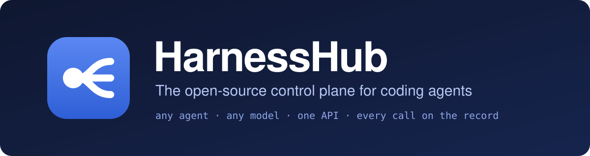
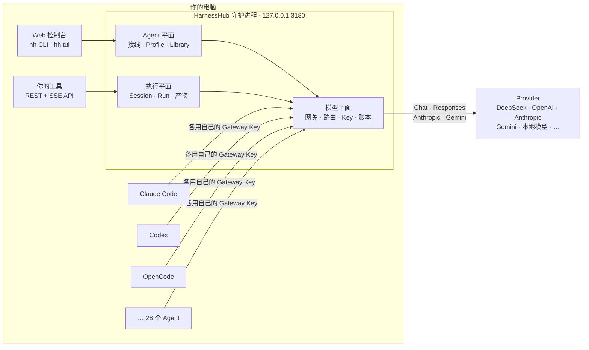

<div align="center">



<br>

[](https://github.com/wyzz973/HarnessHub/actions/workflows/ci.yml)
[](https://github.com/wyzz973/HarnessHub/actions/workflows/codeql.yml)
[](https://github.com/wyzz973/HarnessHub/actions/workflows/scorecard.yml)
[](LICENSE)


**让任意编码 Agent 使用任意模型，通过一套 API 无人值守地运行它们，并保留每一次模型调用的证据。**

[快速上手](#快速上手) · [为什么需要它](#为什么需要-harnesshub) · [工作方式](#工作方式) · [文档](docs/README.md) · [路线图](ROADMAP.md) · [English](README.md)

<br>


<sub>44 秒了解 HarnessHub · <a href="docs/assets/promo.mp4?raw=true">下载 1080p MP4</a>（片中文字为英文）</sub>

</div>

> 本文是 [英文 README](README.md) 的译文，两者不一致时以英文为准。

> [!NOTE]
> **预发布（里程碑 M0）。** 目前没有正式发布的版本，只能在自己的电脑上从源码运行，0.1 之前接口还会变化。各里程碑的交付见 [路线图](ROADMAP.md)。

---

## 为什么需要 HarnessHub

你很可能同时用着不止一个编码 Agent：这件事用 Claude Code，那件事用 Codex，另一件用 OpenCode 或 Qwen Code。它们各有各的模型设置、API Key、对“工具”的理解，以及看不透的账单。想让所有 Agent 试用同一个模型、让某个 Agent 无人值守地跑任务、或者弄清钱花在了哪里，你就得手工改十几个配置文件。

HarnessHub 是跑在你自己电脑上的一个守护进程，替你做这些事。

- **在一个地方给所有 Agent 换模型。** 选一次模型，HarnessHub 先给你看改动，再写进每个 Agent 自己的配置。
- **让 Agent 在没人守着时工作。** 通过 REST + SSE API 启动 Agent、回应它的权限请求、收取它产出的文件。
- **知道发生了什么。** 每次模型调用都是账本里的一行。Agent 退出码为 0 不算任务完成；模型调用结算完毕、声明的输出校验通过，才算。

数据不离开你的电脑。没有托管服务、没有账号、没有遥测。

## 亮点

<table>
<tr>
<td width="33%" valign="top">

### 模型平面
本地网关支持 OpenAI **Chat Completions**、OpenAI **Responses**、**Anthropic Messages** 与 **Gemini** 协议，可直通，也可在它们之间转换。

- 46 个 provider 预设，也可自己添加
- 路由组、规则、重试与故障转移
- 按 Key 的模型白名单与预算
- 记录用量与费用的 `model.call` 账本
- 把 ChatGPT、GitHub Copilot 订阅作为 provider

</td>
<td width="33%" valign="top">

### Agent 平面
编辑本机已安装 Agent **自己的**配置文件来接线，绝不悄悄进行。

- 28 个 Agent，各有自己的 Gateway Key
- 预览、逐字节备份与还原
- 你自己改了文件时报告漂移
- 用 Profile 保存命名的配置
- Library 管理指令、MCP 服务与 Skills，同步到 9 个 Agent

</td>
<td width="33%" valign="top">

### 执行平面
无人值守地运行 Agent，并记录它做了什么。

- SQLite 中的持久 Session 与 Run
- 从已提交事件重放 SSE
- 期限、取消、幂等提交
- 经 API 往返的权限请求
- 声明的输出存为带 SHA-256 的不可变产物
- ACP 与 CLI 驱动，每个 Session 一份私有配置

</td>
</tr>
</table>

**周边能力：**由守护进程自己提供的 Web 控制台（React，中英文）、终端界面（`hh tui`）、加密备份与 WebDAV/S3 同步、模型调用的 OTLP 导出、存放在系统钥匙串中的秘密，以及把一个网关共享给局域网内其他电脑。

## 工作方式



一切都在同一个进程、同一个端口里。执行平面与模型平面同在其中，所以一次任务的模型调用天然记在这次任务上，证据来自做这件事的同一个系统。

### 重要的设计取舍

| 取舍 | 原因 |
|---|---|
| **每个 Agent 一把 Gateway Key** | 可以单独吊销、限额或审计某个 Agent，不影响其他。Key 只存哈希；provider 凭据进系统钥匙串，不写进 Agent 的文件。 |
| **报告漂移，不覆盖** | HarnessHub 接线之后你又改了 Agent 的配置，会被报告为漂移，而不是被悄悄重写。 |
| **先预览再写入** | 每次接线都显示精确的文件改动、备份原始字节、原子写入、回读校验，并可逐字节还原。 |
| **以证据判定结果** | Run 由模型调用账本和校验过的产物结算。退出码 0、事件流断开或 Agent 说“完成了”都不是证据。 |
| **默认只在本机** | 网关只接受回环连接，直到你打开局域网共享。 |

## 快速上手

### 从源码安装

**前置条件：**Git、Node.js 24.20.0、pnpm 10.12.3（`corepack enable` 即可提供）。macOS 上需要 Xcode Command Line Tools 来构建 Keychain 辅助程序。

```sh
git clone https://github.com/wyzz973/HarnessHub.git
cd HarnessHub
pnpm install --frozen-lockfile
pnpm build && pnpm build:console
```

### 运行

**1. 启动守护进程。**

```sh
pnpm exec hh serve
```

它监听 `127.0.0.1:3180`，数据放在 `./data`，并打印一个登录控制台的一次性链接。

**2. 添加 provider 并接入 Agent。**在第二个终端：

```sh
pnpm exec hh init
```

向导会从预设添加 provider、不回显地询问它的 Key、列出本机已安装的 Agent，把所有文件改动合在一起显示，你确认后再把它们接到你选的模型。脚本里可以这样：

```sh
pnpm exec hh init --preset deepseek --credential-from-env DEEPSEEK_API_KEY \
  --agents claude,codex --model deepseek/<model> --yes
```

**3. 经网关调用模型。**

```sh
HH_KEY=$(pnpm exec hh key create --name me --allow 'deepseek/*')
curl http://127.0.0.1:3180/v1/chat/completions \
  -H "Authorization: Bearer $HH_KEY" -H 'content-type: application/json' \
  -d '{"model":"deepseek/<model>","messages":[{"role":"user","content":"Hello"}]}'

pnpm exec hh usage --by model --since 1d
```

**没有 API Key？**仓库自带一个[假 provider](tools/fake-provider/README.md)，对每个请求返回固定文本、不调用任何真实模型，足以试用上面的每一步。

<details>
<summary><b>更多可以试的命令</b></summary>

```sh
pnpm exec hh agents                         # 哪些 Agent 已安装、已接线、有漂移
pnpm exec hh wire codex deepseek/<model>    # 预览、确认、接线一个 Agent
pnpm exec hh tui                            # 同样的事，在终端里做
pnpm exec hh unwire codex                   # 还原它的文件并吊销它的 Key
pnpm exec hh console                        # 为 Web 控制台生成新的登录链接
```

OpenAI 客户端使用 `http://127.0.0.1:3180/v1` 作为基址；Anthropic 与 Gemini 客户端使用 `http://127.0.0.1:3180`；API Key 填 Gateway Key。`hh status` 会打印这些地址。

</details>

完整的上手说明，包括数据目录与排错，见 [入门指南](docs/getting-started.md)。

## 支持的 Agent

Agent 平面接线 **28 个 Agent**，每个都依照该 Agent 读取自身配置的方式。部分如下：

| | | | |
|---|---|---|---|
| Claude Code | Codex CLI | Gemini CLI | Qwen Code |
| OpenCode | Crush | Pi | Kimi Code |
| Hermes Agent | Droid | Cline CLI | Qoder |
| Claude Desktop | WorkBuddy | dsh | Command Code |

每个 Agent 写哪些文件与键、写入的安全规则见 [全局接线](docs/global-wiring.md)；这些 Agent 实际运行时的表现见 [兼容性](docs/compatibility.md)。

## HarnessHub 的位置

这个赛道有三层，很少有项目把它们合在一起：

| 层 | 回答的问题 | 代表项目 | HarnessHub |
|---|---|---|---|
| **模型** | 每个 Agent 用哪个模型？ | CC Switch、claude-code-router、[Magpie](https://github.com/yetone/magpie)、LiteLLM | 与 Magpie 持平；这些项目也都可以作为上游 provider |
| **执行** | 怎样让 Agent 无人值守地干活？ | OpenHands、sandbox-agent、acpx | 主战场 |
| **观测** | 发生了什么、花了多少？ | ccusage、Langfuse、OpenTelemetry | 账本与 Run 事件就是证据，经 OTLP 导出到你已有的系统 |

HarnessHub 的模型平面与 Agent 平面用 TypeScript 重新实现了 yetone 的 [Magpie](https://github.com/yetone/magpie)（MIT，Go）的能力，逐项对照其源码，并在其上加入执行平面。感谢该项目提供的设计与对每个 Agent 的逐字段了解。[HarnessHub for Magpie users](docs/magpie-parity.md)（英文）逐个领域对比两者，包括差距。定位以及已做与未做的如实对照见 [HarnessHub 的定位](docs/features/positioning.md)。

## 当前状态

| | |
|---|---|
| **已测试** | `pnpm check`（构建、lint、单元、集成、冒烟、508 条协议一致性用例）在 macOS arm64 上通过 |
| **未验证** | Windows 支持已实现，但尚未在 Windows 上运行；单可执行文件只在 macOS arm64 上构建过 |
| **真实 provider 与 Agent** | 只用 DeepSeek 端到端跑过；真实 Agent 的结果见 [兼容性](docs/compatibility.md) |
| **即将到来** | 执行平面带版本的 `/api/v1` 与 SDK、每个任务的用量、多 Agent 对比运行、第一个可安装的版本（[路线图](ROADMAP.md)） |

## 文档

| 主题 | 从这里开始 |
|---|---|
| 安装与配置 | [快速开始](docs/quickstart.md) · [配置](docs/configuration.md) · [控制台](packages/console/README.md) |
| 模型网关 | [模型网关](docs/model-gateway.md) · [provider 预设](docs/provider-presets.md) · [网关功能](docs/gateway-features.md) |
| Agent | [全局接线](docs/global-wiring.md) · [Library](docs/library.md) |
| HTTP API | [概览](docs/api/README.md) · [参考](docs/api/reference.md) · [OpenAPI](docs/api/openapi.json) |
| 设计 | [开源设计](docs/proposals/oss/README.md) · [DESIGN.md](DESIGN.md) · [架构](docs/architecture.md) · [决策记录](docs/decisions/README.md) |

完整索引见 [文档索引](docs/README.md)。

## 开发

```sh
pnpm check              # 构建、lint、测试、API 与文档检查、控制台构建
pnpm bench              # 网关延迟与账本吞吐，对照 M1 目标
pnpm test:conformance   # 本机已安装的真实 Agent，在沙箱中离线运行（macOS）
```

每次改动遵循的规则见 [AGENTS.md](AGENTS.md)、[开发规范](docs/development.md) 与 [测试要求](docs/testing.md)。仓库是 monorepo，拆为 `packages/`（`gateway`、`agents`、`runtime`、`drivers`、`store`、`secrets`、`daemon`、`console`、`sdk` 等），导入边界由 `pnpm check:boundaries` 强制。

## 参与贡献

欢迎贡献。请先读 [CONTRIBUTING.md](CONTRIBUTING.md)；提交按 [Developer Certificate of Origin](https://developercertificate.org/) 接收（`git commit -s`）。安全漏洞请按 [SECURITY.md](SECURITY.md) 私下报告，使用问题见 [SUPPORT.md](SUPPORT.md)，项目决策方式见 [GOVERNANCE.md](GOVERNANCE.md)。

HarnessHub 由 [@wyzz973](https://github.com/wyzz973) 拥有。日常开发与维护由 AI 维护者（Claude）在所有者授权下进行，每次改动都经过同样的自动化检查。

## 许可证

[MIT](LICENSE)。取自其他项目的代码与数据保留原许可证，列在 [THIRD_PARTY_NOTICES.md](THIRD_PARTY_NOTICES.md)。

HarnessHub 与 GitHub 组织 `HarnessHub`、Harness Inc. 以及它所适配的 Agent 与模型的厂商均无隶属关系；产品名称仅用于说明兼容性，见 [TRADEMARKS.md](TRADEMARKS.md)。早期的单模型版本保留在 `archive/competition` 分支。
