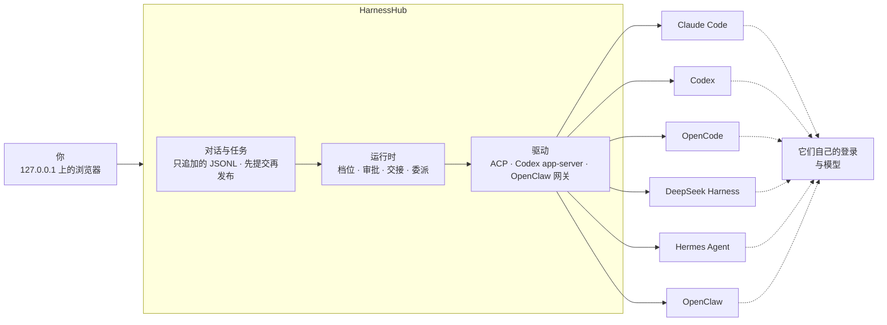

<div align="center">


<br>

[](LICENSE)


**一个对话，用上你 Mac 上已经装好的 Claude Code、Codex、OpenCode、Hermes、OpenClaw 等编码 Harness。<br>每一家都沿用它自己的安装、登录和模型。**

[快速上手](#快速上手) · [为什么](#为什么需要-harnesshub) · [工作方式](#工作方式) · [支持的 Harness](#支持的-harness) · [文档](docs/README.md) · [English](README.md)

<br>

https://github.com/user-attachments/assets/9a2af277-9fa9-48e8-9d26-08b61bc80ca8

<sub>52 秒，带配乐：OpenCode 规划，Claude Code 实现，Codex 审查，DeepSeek Harness 验收，OpenClaw 报告 · <a href="docs/assets/promo.mp4?raw=true">下载 1080p MP4</a>（字幕为英文，界面为中文）</sub>

</div>

> 本文是 [英文 README](README.md) 的译文，两者不一致时以英文为准。

> [!NOTE]
> **预发布，只支持 macOS。** HarnessHub 在你自己的 Mac 上从源码运行，还没有正式发布的版本，界面目前只有中文。下面每一条说法都链接到它依据的证据；[还没做完的部分](#当前状态)也同样写明。

---

## 为什么需要 HarnessHub

你手上的编码 Harness 不止一个：一个终端里开着 Claude Code，另一个开着 Codex，别处还有 OpenCode、Hermes 或 OpenClaw。每一家都有自己的窗口、自己选模型的方式、自己的审批和自己的历史。一件事超出一家的能力，你就得把上下文手工搬到下一家。

HarnessHub 把它们放进**同一个对话**：

- **从一个地方问任何一家。** 这条消息交给 Claude Code，下一条交给 Codex；对话、历史和你的草稿都留在原处。
- **让它们一起干活。** 做到一半换一家接着做，或者把其中一段交给另一家。整件任务由 HarnessHub 记着：你说过的话、每一家做了什么、改了哪些文件。下一家拿到它需要的，其余的自己去读。
- **不做仿冒。** HarnessHub 驱动你装好的那个程序，走它自己的接口（ACP、Codex 的 app-server、OpenClaw 的网关）；用你的登录和它已经提供的模型。它从不建空的配置目录，也不改你的全局模型设置。
- **原生能力原样接出。** 模型、思考强度、模式和命令都从各家读取；审批、提问、计划、带差异的工具调用、子 Agent 和用量，按那一家报告的样子出现在对话里。
- **替你照看这些 Harness。** HarnessHub 只认官网渠道的安装，可以按厂商写明的方式安装、升级或卸载每一家，运行任何命令之前都先列给你看。

一切都留在你的电脑上：页面只在 `127.0.0.1` 提供，用一次性链接登录；数据是你自己的一个文件夹，每个对话一个只追加的 JSONL 文件。

## 亮点

<table>
<tr>
<td width="50%" valign="top">

### 一个对话
- 对话不属于任何一家 Harness：两条消息之间就能换 Harness、模型或思考强度，没有“应用”按钮
- 每一家都有五档权限和五档思考强度，用它自己的设置来落实；某一档它没有对应设置时，由 Hub 来落实
- 审批停在输入框的位置：<kbd>⏎</kbd> 允许，<kbd>esc</kbd> 拒绝
- 计划、带差异的工具调用、子 Agent 和用量，按各家报告的样子显示
- 恢复、分支、编辑并重发；清空就是开一个新的原生会话
- 回复经 SSE 流式显示，刷新不丢失，也不会重复发送

</td>
<td width="50%" valign="top">

### 多家一起干活
- 做到一半换人：下一家拿到前面的对话，最多占它上下文窗口的一半；回到原来那家时，只补它没看到的部分
- 把一段活委派给另一家：可以从菜单发起，也可以由 Harness 自己发起；它在自己的对话里做，结果自己回来
- 一块任务板，任务里的每一家都照着它做
- 整件任务的记录是一组只读文件，每一家用自己的工具读
- 某一家压缩了上下文之后，Hub 把任务现在的状态再交给它

</td>
</tr>
<tr>
<td width="50%" valign="top">

### 编码工作台
- 做完的一轮收成一行，下面一张卡片列出改了哪些文件
- 改动可以按轮、按对话或按 Git 范围看，能并排对比，能对某几行写评语
- 需要时给对话开一个自己的 Git 工作树；每轮前后拍快照，在这个工作树里编辑并重发时，可以把文件还原
- 用你自己的 `gh` 提交、推送、建 PR
- 终端一直开着，一键在你的编辑器里打开
- 一轮进行中可以插话（Claude Code、Codex）；<kbd>⌘</kbd><kbd>K</kbd> 搜所有对话

</td>
<td width="50%" valign="top">

### 照看你的 Mac
- 只认官网渠道的安装：npm、Homebrew、厂商脚本、uv
- 安装、升级、卸载前预览每一条命令
- 升级后按产品自己的方式重启它的后台服务，并确认它重新运行
- 一个页面统一管理各家的技能、MCP 服务器、说明文件、子 Agent 与插件：只改用户级配置，每次写入前先预览

</td>
</tr>
</table>

## 工作方式



对话属于 HarnessHub，每一家在下面保留自己的原生会话。事实先写到磁盘上再显示，所以刷新会如实重放发生过的事，结果未知的执行也不会被自动重跑。

切换时，下一家拿到一份交接单：前面的对话，最多占它上下文窗口的一半，省略了什么写得清清楚楚。回到一个它已经有的原生会话时，只补它没见过的部分；只用一家时，什么都不加。

每一家还会从 Hub 拿到几个工具，走会话的 MCP 服务器（OpenClaw 用一条命令来调）：任务清单和收尾小结（页面上会显示）、任务板、委派给另一家。整件任务的记录（任务里的每段对话、每一轮的全文）是一个只读文件夹，每一家用自己读文件的工具去读。某一家压缩了上下文，下一次调工具时就拿回任务现在的状态；只有原生会话接不下去了，Hub 才开一个新的。

厂商 SDK 的类型留在驱动里。每一家怎么适配，写在它自己的一份声明里；其余代码从不按“现在是哪一家”分支。

## 支持的 Harness

HarnessHub 按每家最新的正式版适配（[ADR-053](docs/decisions/0053-latest-version-baseline.md)）。[适配矩阵](docs/contracts/harness-adapters.md)逐家逐项写明怎么适配（原生、会话参数，或由 Hub 按档位处理），以及在真实安装上核对过什么。

| Harness | 接入方式 | Hub 的工具怎么到它那里 | 一轮进行中插话 |
|---|---|---|---|
| **Claude Code** | ACP，经 `claude-agent-acp` 绑定你自己的 `claude` | 会话级 MCP，追加系统提示 | 能 |
| **Codex** | Codex app-server | 线程级 MCP 配置，developer instructions | 能 |
| **OpenCode** | ACP（`opencode acp`） | 会话级 MCP | 原生没有 |
| **DeepSeek Harness** | ACP，经 `dsh` 自己的 profile | 会话级 MCP | 原生没有 |
| **Hermes Agent** | ACP，附着到你正在运行的网关 | 会话级 MCP | 原生没有 |
| **OpenClaw** | ACP，加上你自己的 OpenClaw 网关 | 给这段对话的一条命令，它用自己的 exec 工具来调 | 原生没有 |
| **WorkBuddy** | 计划中：用 WorkBuddy 内嵌的 CodeBuddy CLI，共用它自己的数据（[ADR-048](docs/decisions/0048-harness-scope-and-workbuddy.md)） | 尚未接入 | 尚未接入 |

六家都有五档权限和五档思考强度（按模型支持的就近对应）、计划模式、审批、原生 `/` 命令、附件、用量、恢复与分支（能原生分支的走原生，其余由 Hub 来做）。Cursor、Gemini CLI 和 Pi 也有驱动，但已冻结并默认隐藏。目录描述了 45 个产品，列在目录里不代表可以驱动。

## 快速上手

**前置条件：** macOS、Node.js 24 或以上、pnpm 10.12.3，以及上表中至少一个按官网方式安装并登录好的 Harness。可选：`git`（改动页和工作树要用），登录好的 `gh`（建 PR 要用）。

```sh
git clone https://github.com/wyzz973/HarnessHub.git
cd HarnessHub
pnpm install --frozen-lockfile --ignore-scripts
pnpm build && pnpm web:build
pnpm web --cwd /path/to/your/project --data-dir data --port 4317
```

打开它打印的一次性链接。令牌会换成本机 cookie 并从地址栏移除；服务只监听 `127.0.0.1`，登录在你使用期间一直有效，8 小时没有活动才失效。关掉页面不会取消回复，<kbd>Ctrl</kbd>+<kbd>C</kbd> 会等进行中的工作收尾并保留历史。

服务运行期间独占它的 `--data-dir`。每个对话是 `data/sessions/` 下一个只追加的 JSONL 文件，每件任务的记录在 `data/context/` 下。不选文件夹的对话在 `~/HarnessHub/chats` 里干活，要了自己工作树的对话，工作树在 `~/HarnessHub/worktrees` 下。`pnpm web --help` 列出全部参数。

<details>
<summary><b>不用网页</b></summary>

```sh
pnpm discover                                    # 本机找到的官网安装，含渠道与版本
pnpm chat --harness codex --data-dir data --cwd /path/to/project
pnpm sessions list --data-dir data --json        # 对话列表
```

在 `pnpm chat` 里，`:harness opencode` 切换 Harness，`:cancel` 停止当前回合，`:history` 打印历史，`:quit` 退出。每个命令都可以加 `--help`。

</details>

## 当前状态

HarnessHub 处于预发布阶段。为了说法如实，项目把“已实现”“合成测试通过”“真实 Harness 通过”分开表述，[功能清单](docs/product/features.md)逐条这样标注。

| | |
|---|---|
| **已测试** | `pnpm check` 通过（构建、前端构建、依赖边界、界面措辞与工具检查）。最近一次全量运行（2026-11-14，macOS arm64）：`pnpm test` 1,312 项通过，浏览器测试 `pnpm test:web` 114 项通过 |
| **真实 Harness** | [适配矩阵](docs/contracts/harness-adapters.md)的每一格都写明在真实安装上核对了什么、什么时候核对的；[决定记录](docs/decisions/LOG.md)记下每次真机运行，以及它没覆盖的部分 |
| **多家协作** | [委派上下文尺子](docs/verification/delegation-ruler.md)在 Claude Code（用 Haiku）、DeepSeek Harness 和 Codex 之间交接真实的任务。2026-11-14 按默认设置跑了一次：S1–S14 通过（S14 带上了 Claude Code 的提早压缩开关）；S15 Codex 通过，Claude Code 做完了，但因为列了工作区外的一个文件夹被判不过 |
| **只有合成测试** | 建 PR 和推送到真实的远端；Claude Code 的快档；上下文窗口超出或会话丢失后开新的原生会话。其余列在[功能清单](docs/product/features.md)里 |
| **还没做** | 多段对话共用的常驻原生宿主池（[ADR-056](docs/decisions/0056-native-hosts-and-sessions.md)），现在是每段对话保留自己的原生进程；打包好的应用，这需要给终端用的 `node-pty` 签名并公证 |
| **以后** | WorkBuddy；统一管理模型 Provider（目前每一家用它已经配置好的模型） |
| **不再计划** | Windows 与 Linux（[ADR-044](docs/decisions/0044-macos-official-channels.md)） |
| **关于宣传片** | 片中的接力、对话内容和数字都是示意。五棒的分工按各家公认的长处安排；把总结发到手机是 OpenClaw 自己的消息功能，还没有经 HarnessHub 实测 |

## 文档

| 主题 | 从这里开始 |
|---|---|
| 现在能做什么 | [功能清单](docs/product/features.md)，每一条的证据和还没做的 |
| 每一家、每一项 | [适配矩阵](docs/contracts/harness-adapters.md) |
| 决定与真机运行 | [决定记录](docs/decisions/LOG.md)，新的在上 · [ADR 索引](docs/decisions/README.md)，共 50 篇 |
| 证据 | [验证记录](docs/verification/) · [委派上下文尺子](docs/verification/delegation-ruler.md) · [接力尺子](docs/verification/relay-ruler.md) |
| 阅读顺序 | [docs/README.md](docs/README.md) |

`plan/`、`TASKS.md`、测试矩阵、不变量表和就绪门禁 2026-11-11 起不再维护；[工程现状](docs/engineering/status.md)和生成的[能力矩阵](docs/verification/native-capability-matrix.md)是更早的快照。它们都留作参考。

## 开发

```sh
pnpm check       # 构建、前端构建、依赖边界检查、界面措辞检查、工具自检
pnpm test        # 单元与集成测试，使用真实文件与进程
pnpm test:web    # 在真实浏览器里测试页面（先运行 pnpm exec playwright install chromium）
```

`pnpm test:real:*` 驱动本机装好的 Harness，用的是真实模型。这里怎么干活写在 [AGENTS.md](AGENTS.md)：小步做、每一片都在真机上试；提交前要能构建；事实先提交再发布；不改你真实的 Harness 配置；汇报时把“代码完成”“合成测试通过”“真机通过”分开说。

## 许可证

[MIT](LICENSE)。品牌图标来自 [Lobe Icons](https://github.com/lobehub/lobe-icons)（MIT）及 [web/THIRD_PARTY_ASSETS.md](web/THIRD_PARTY_ASSETS.md) 列出的其他来源；产品名称与标志归各自所有者，只用于辨认 HarnessHub 适配的 Harness。HarnessHub 与 Anthropic、OpenAI、DeepSeek、Nous Research、腾讯、OpenCode 与 OpenClaw 项目以及 GitHub 组织 `HarnessHub` 均无隶属关系。

项目的工程名是 HarnessGateway，所以包名是 `harness-gateway`。HarnessHub 早期的控制平面版本保留在 [`archive/control-plane`](https://github.com/wyzz973/HarnessHub/tree/archive/control-plane) 分支。
