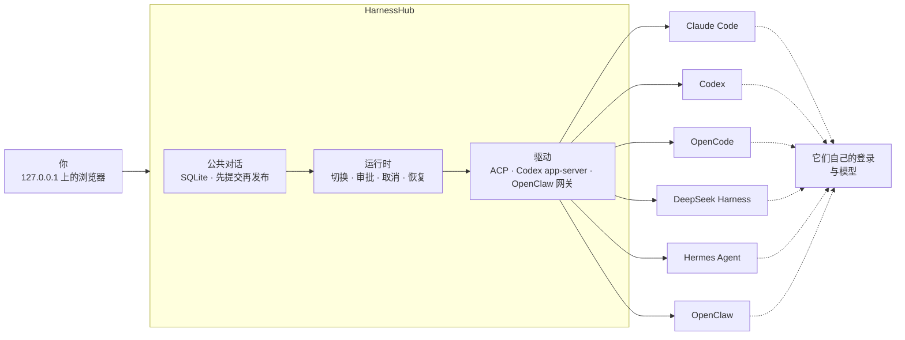

<div align="center">


<br>

[](LICENSE)


**一个对话，用上你 Mac 上已经装好的 Claude Code、Codex、OpenCode、Hermes、OpenClaw 等编码 Harness。<br>每一家都沿用它自己的安装、登录和模型。**

[快速上手](#快速上手) · [为什么](#为什么需要-harnesshub) · [工作方式](#工作方式) · [支持的 Harness](#支持的-harness) · [文档](docs/README.md) · [English](README.md)

<br>

https://github.com/user-attachments/assets/9a2af277-9fa9-48e8-9d26-08b61bc80ca8

<sub>52 秒，带配乐：OpenCode 规划，Claude Code 实现，Codex 审查，DeepSeek Harness 验收，OpenClaw 报告 · <a href="docs/assets/promo.mp4?raw=true">下载 1080p MP4</a>（字幕为英文，界面为中文）</sub>

</div>

> 本文是 [英文 README](README.md) 的译文，两者不一致时以英文为准。

> [!NOTE]
> **预发布，只支持 macOS。** HarnessHub 在你自己的 Mac 上从源码运行，还没有正式发布的版本，界面目前只有中文。下面每一条说法都链接到它依据的证据；[还没做完的部分](#当前状态)也同样写明。

---

## 为什么需要 HarnessHub

你手上的编码 Harness 不止一个：一个终端里开着 Claude Code，另一个开着 Codex，别处还有 OpenCode、Hermes 或 OpenClaw。每一家都有自己的窗口、自己选模型的方式、自己的审批和自己的历史。一件事超出一家的能力，你就得把上下文手工搬到下一家。

HarnessHub 把它们放进**同一个对话**：

- **从一个地方问任何一家。** 这条消息交给 Claude Code，下一条交给 Codex；对话、历史和你的草稿都留在原处。
- **不做仿冒。** HarnessHub 驱动你装好的那个程序，走它自己的接口（ACP、Codex 的 app-server、OpenClaw 的网关）；用你的登录和它已经提供的模型。它从不建空的配置目录，也不改你的全局模型设置。
- **原生能力原样接出。** 模型、思考强度、模式和命令都从各家读取；审批、提问、计划、带差异的工具调用、子 Agent 和用量，按那一家报告的样子出现在对话里。
- **替你照看这些 Harness。** HarnessHub 只认官网渠道的安装，可以按厂商写明的方式安装、升级或卸载每一家，运行任何命令之前都先列给你看。

一切都留在你的电脑上：页面只在 `127.0.0.1` 提供，用一次性链接登录，数据存在你自己的 SQLite 数据库里。

## 亮点

<table>
<tr>
<td width="33%" valign="top">

### 一个对话
- 公共对话不属于任何一家 Harness
- 两条消息之间就能换 Harness、模型或思考强度，没有“应用”按钮
- 换人的地方有一条“从这里起由 X 接手”的分隔线
- 接续某家自己的会话，或从任一回复分支
- 回复经 SSE 流式显示，刷新不丢失，也不会重复发送

</td>
<td width="33%" valign="top">

### 每家原生
- 模型、思考强度、模式和 `/` 命令来自各家自己
- 审批停在输入框的位置：<kbd>⏎</kbd> 允许一次，<kbd>esc</kbd> 拒绝
- 计划、带差异的工具输入与输出、子 Agent、压缩、用量
- 文件、图片和音频按各家自己的输入方式发送
- `/compact` 与 `/export` 交给有这些命令的那一家自己执行

</td>
<td width="33%" valign="top">

### 照看你的 Mac
- 只认官网渠道的安装：npm、Homebrew、厂商脚本、uv
- 安装、升级、卸载前预览每一条命令
- 升级后按产品自己的方式重启它的后台服务，并确认它重新运行
- 一个页面统一管理各家的技能、MCP 服务器、指令、命令、Hooks 与插件：只改用户级配置，每次写入前先预览

</td>
</tr>
</table>

## 工作方式



对话属于 HarnessHub，每一家在下面保留自己的原生会话。事实先写进数据库再显示，所以刷新会如实重放发生过的事，结果未知的执行也不会被自动重跑。切换时，下一家拿到的是有边界的对话上下文；回到一个它已经有的原生会话时，只补它没见过的部分。厂商 SDK 的类型留在驱动里，其余代码从不按“现在是哪一家”分支。

## 支持的 Harness

HarnessHub 聚焦七个 Harness（[ADR-046](docs/decisions/0046-harness-focus-hardening.md)），并按每家最新的正式版适配（[ADR-053](docs/decisions/0053-latest-version-baseline.md)）。[能力矩阵](docs/verification/native-capability-matrix.md)逐家记录 27 项原生功能，每一项都有来源和证据。

| Harness | 接入方式 | 已在 HarnessHub 完成的原生功能（共 27 项） |
|---|---|---|
| **Claude Code** | ACP，经 `claude-agent-acp` 绑定你自己的 `claude` | 22 |
| **Codex** | Codex app-server | 20 |
| **OpenCode** | ACP（`opencode acp`） | 16 |
| **Hermes Agent** | ACP，附着到你正在运行的网关 | 16 |
| **DeepSeek Harness** | ACP，经 `dsh` 自己的 profile | 13 |
| **OpenClaw** | ACP，加上你自己的 OpenClaw 网关 | 10 |
| **WorkBuddy** | 计划中：用 WorkBuddy 内嵌的 CodeBuddy CLI，共用它自己的数据（[ADR-048](docs/decisions/0048-harness-scope-and-workbuddy.md)） | 尚未接入 |

“完成”指 HarnessHub 已实现；哪些在本机真实 Harness 上通过，矩阵另行记录。Cursor、Gemini CLI 和 Pi 也有驱动，但已冻结在焦点之外。目录描述了 45 个产品，列在目录里不代表可以驱动。

## 快速上手

**前置条件：** macOS、Node.js 24 或以上、pnpm 10.12.3，以及上表中至少一个按官网方式安装并登录好的 Harness。

```sh
git clone https://github.com/wyzz973/HarnessHub.git
cd HarnessHub
pnpm install --frozen-lockfile --ignore-scripts
pnpm build && pnpm web:build
pnpm web --cwd /path/to/your/project --data-dir data --port 4317
```

打开它打印的一次性链接。令牌会换成本机 cookie 并从地址栏移除；服务只监听 `127.0.0.1`。关掉页面不会取消回复，<kbd>Ctrl</kbd>+<kbd>C</kbd> 会等进行中的工作收尾并保留历史。服务运行期间独占它的 `--data-dir`。

<details>
<summary><b>不用网页</b></summary>

```sh
pnpm discover                                    # 本机找到的官网安装，含渠道与版本
pnpm chat --harness codex --data-dir data --cwd /path/to/project
pnpm sessions list --data-dir data --json        # 公共对话
```

在 `pnpm chat` 里，`:harness opencode` 切换 Harness，`:cancel` 停止当前回合，`:history` 打印公共历史。全部命令与参数见 [工程现状](docs/engineering/status.md)。

</details>

## 当前状态

HarnessHub 处于预发布阶段。为了说法如实，项目把“已设计”“已实现”“合成测试通过”“真实 Harness 通过”分开表述：

| | |
|---|---|
| **已测试** | `pnpm check`（构建、前端构建、设计、依赖边界与工具检查）、`pnpm test`（941 项通过）与浏览器测试 `pnpm test:web` 在 macOS arm64 上运行 |
| **真实 Harness** | 逐项记录在[能力矩阵](docs/verification/native-capability-matrix.md)与[验证记录](docs/verification/)中；有些功能受测试账号的套餐或额度限制，标为受阻 |
| **已设计、部分实现** | 接力，即不同 Harness 之间的上下文交接（[ADR-055](docs/decisions/0055-relay-and-context-scheduling.md)）；用常驻的原生宿主代替每回合一个进程（[ADR-056](docs/decisions/0056-native-hosts-and-sessions.md)） |
| **不再计划** | Windows 与 Linux（[ADR-044](docs/decisions/0044-macos-official-channels.md)） |
| **以后** | 统一管理模型 Provider；目前每一家用它已经配置好的模型 |
| **关于宣传片** | 片中的接力、对话内容和数字都是示意。五棒的分工按各家公认的长处安排；把总结发到手机是 OpenClaw 自己的消息功能，还没有经 HarnessHub 实测 |

## 文档

| 主题 | 从这里开始 |
|---|---|
| 总览与阅读顺序 | [docs/README.md](docs/README.md) · [工程现状](docs/engineering/status.md) |
| 决策 | [ADR 索引](docs/decisions/README.md)，共 49 篇 |
| 契约与不变量 | [契约](docs/contracts/) · [不变量](docs/domain/invariants.md) |
| 证据 | [能力矩阵](docs/verification/native-capability-matrix.md) · [验证记录](docs/verification/) |
| 计划 | [任务](TASKS.md) · [测试矩阵](docs/engineering/test-matrix.md)，由 [`plan/`](plan/) 生成 |

## 开发

```sh
pnpm check       # 构建、前端构建、设计检查、依赖边界检查、工具自检
pnpm test        # 单元、集成、协议与恢复测试，使用真实文件与进程
pnpm test:web    # 在真实浏览器里测试页面（先运行 pnpm exec playwright install chromium）
```

每次改动遵循的规则见 [AGENTS.md](AGENTS.md)、[开发规范](docs/engineering/development.md) 与 [测试要求](docs/engineering/testing.md)：每个文件一个所有者，先定契约再写代码，事实先提交再发布，任何替代真实 Harness 的测试都要写明。

## 许可证

[MIT](LICENSE)。品牌图标来自 [Lobe Icons](https://github.com/lobehub/lobe-icons)（MIT）及 [web/THIRD_PARTY_ASSETS.md](web/THIRD_PARTY_ASSETS.md) 列出的其他来源；产品名称与标志归各自所有者，只用于辨认 HarnessHub 适配的 Harness。HarnessHub 与 Anthropic、OpenAI、DeepSeek、Nous Research、腾讯、OpenCode 与 OpenClaw 项目以及 GitHub 组织 `HarnessHub` 均无隶属关系。

项目的工程名是 HarnessGateway，所以包名是 `harness-gateway`。HarnessHub 早期的控制平面版本保留在 [`archive/control-plane`](https://github.com/wyzz973/HarnessHub/tree/archive/control-plane) 分支。
